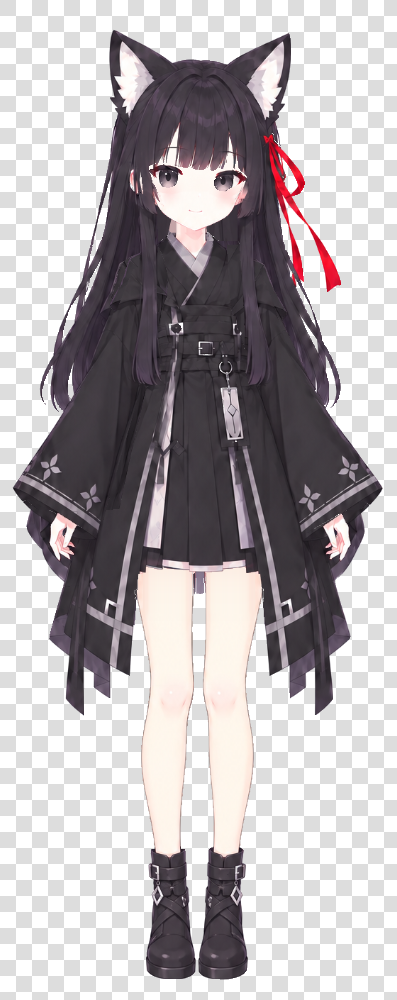
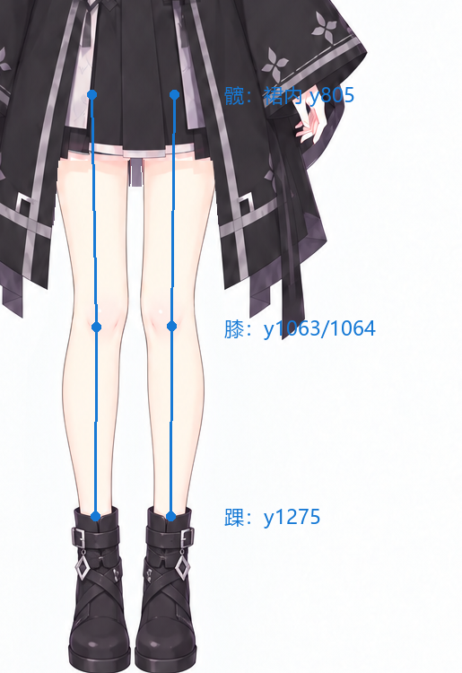

# SakuraMitsuha Desktop Pet · 佐仓三叶桌宠

<p align="center">
  
</p>

基于 [CeTaPet-AI-DeskTopPet-DeepSeek](https://github.com/kmjs1915/CeTaPet-AI-DeskTopPet-DeepSeek) 二次开发的佐仓三叶桌宠。项目有独立的 Q 版分层形象，以及另一套经过拆件、建模和骨骼绑定的写实形象。桌宠目前可在两种形象间切换，并支持 DeepSeek 聊天与桌面交互。

## 两套角色模型

| Q 版 | 写实版 |
| --- | --- |
| 11 张分层图片组成，默认显示；支持待机、眨眼、呼吸、发摆和五种表情。 | 独立的 Live2D/Cubism 制作路线，已有模型、贴图、骨骼绑定及表情数据。桌宠当前使用 v11 模型预先渲染的 6 秒动画帧循环。 |

上方全身图展示写实模型的 v17 制作预览。下图是 v11 腿部骨骼与关节位置的局部示意，并非整套骨骼图：

<p align="center">
  
</p>

制作目录另有后续模型版本：v22 增加发带跟随绑定，微风待机曲线也已单独保留。眼脸、衣发衔接及连续变形仍在调整；这些制作版本尚未替换仓库中的 v11 运行包。目前写实版通过预渲染帧播放，暂不在桌宠中实时驱动骨骼。

## 当前功能

- 两种角色形象：Q 版默认显示，写实版提供 v11 模型的 6 秒循环动画。
- 两种样式均可使用透明材质与渐变转场；角色样式从右键菜单切换。
- 左键拖动与位置记忆、角色大小调整、系统托盘及重复启动召回。
- DeepSeek 多轮聊天、账户余额查询、API 密钥设置；可导入 `.txt`、`.docx` 作为聊天参考资料。

## 安装

适用环境：Windows、Python **3.11**。安装 [Python 3.11](https://www.python.org/downloads/) 后克隆仓库并运行安装脚本：

```powershell
git clone https://github.com/78percent/SakuraMitsuha_Desktop_Pet.git
cd SakuraMitsuha_Desktop_Pet
powershell -NoProfile -ExecutionPolicy Bypass -File .\setup_env.ps1
```

脚本会在项目中创建 `.venv` 并安装 `requirements.txt` 中的依赖。聊天需要自己的 DeepSeek API Key，可在项目根目录的 `.env` 中填写：

```dotenv
DEEPSEEK_API_KEY=你的密钥
DEEPSEEK_MODEL=deepseek-flash
```

也可在首次启动时按提示设置密钥。只看角色与动画时可用 `--preview`，无需配置密钥。

```powershell
.\start_pet.cmd
.\start_pet.cmd --preview
```

可选：运行 `install_sakura_shortcut.ps1` 创建桌面快捷方式。需要检查本机依赖及图片资源时，运行 `start_pet.cmd --check`。

## 操作

| 操作 | 效果 |
| --- | --- |
| 左键单击 | 触发角色动作反馈；不弹出台词框 |
| 按住左键拖动 | 移动角色，松开后记住位置；不弹出台词框 |
| 双击角色或托盘图标 | 切换显示状态 |
| 右键角色或托盘图标 | 打开功能菜单 |
| Ctrl + 鼠标滚轮 | 调整角色大小 |
| 再次运行启动器 | 召回已有窗口 |

右键菜单中可以切换“角色样式”，打开聊天与资料、查询 DeepSeek 余额、调整表情和大小、重置位置或退出。写实版当前使用预渲染动画，Q 版的表情与眨眼预览只在 Q 版可用。关闭聊天窗口只会隐藏窗口；完整退出请使用菜单“退出”。

## 资料与隐私

“资料 → 导入资料…”支持 `.txt` 和 `.docx`。**导入会把原文件移动到 `CetaPet/RAG/`**；如需保留原处的文件，请先复制一份。单份资料最多加载 8,000 字，全部资料合计最多 20,000 字，超出的内容会截断。

发送聊天时，当前人设、最近的对话和已加载的参考资料会一并发送给 DeepSeek。密钥保存在本地 `.env`，角色位置与样式配置保存在 `CetaPet/config.json`。这些本地文件和 `CetaPet/RAG/` 不纳入 Git。

## 项目结构

```text
run_pet.py                              启动入口
CetaPet/main.py                         聊天、资料与窗口基础
CetaPet/sakura_pet.py                   角色窗口和菜单
CetaPet/model_selector.py              Q 版与写实版切换
CetaPet/sakura_animation.py            Q 版分层动画
CetaPet/sakura_material.py             透明材质
CetaPet/asset_library/sakura/in-use/   当前运行素材
assets/showcase/                        模型与骨骼展示图
requirements.txt                       运行依赖
```

`CetaPet` 目录名沿用上游结构。写实版 v11 运行包包含动画帧、Cubism 模型、贴图和校验资源；完整的可编辑制作工程及后续试作版本未放入发布仓库。

## 来源与许可

上游项目由 [kmjs1915](https://github.com/kmjs1915) 创建。本项目保留原始 MIT 许可文本，见 [LICENSE](LICENSE) 与 [第三方说明](THIRD_PARTY_NOTICES.md)。角色人设与图片是二次开发内容；上游代码的 MIT 许可不自动涵盖这些素材的单独转载或再分发。
